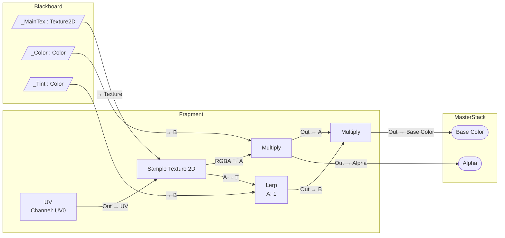

# Shader Teardown — HLSL → Shader Graph diagram

Turn hand-written shader code into a Mermaid diagram that shows how the same shader should be built in Shader Graph. Every node in the diagram must exist, with those exact port names, in the **Shader Graph version the project uses**. Use the docs for that version only.

## 1. Pin the Shader Graph version (always first)

Find the installed `com.unity.shadergraph` version. Check these in order and stop at the first hit:

1. `Packages/packages-lock.json` → `"com.unity.shadergraph": { "version": "17.3.0", ... }`. This is the authoritative source. Shader Graph usually arrives as a URP/HDRP dependency, so it is often **not** in `manifest.json`.
2. `Packages/manifest.json` → `"com.unity.shadergraph"` (only if it was added explicitly).
3. If a Unity Editor is running with `com.unity.pipeline`, `package_list` (see the `unity-pipeline-commands` skill).
4. No project, or none of the above: **ask the user** for the Shader Graph version or Unity version. Do not guess silently.

The docs version is the **major.minor** part: `17.3.0` → `17.3`, `14.0.12` → `14.0`.

Docs base URL (verified for 14.0, 17.0 and 17.3):

```
https://docs.unity3d.com/Packages/com.unity.shadergraph@<major.minor>/manual/
```

- Node library: `Node-Library.html` → category pages `<Category>-Nodes.html` (e.g. `Math-Nodes.html`, `UV-Nodes.html`)
- Single node: `<Node-Name>-Node.html`, words joined by `-` (e.g. `Lerp-Node.html`, `Custom-Function-Node.html`)
- Do **not** use `@latest`, because it returns 404. Always use the pinned version.

The category set differs between versions. For example, 14.0 has no UI or Custom Render Texture categories, and its Master Stack blocks are listed per pipeline (`Built-In-Blocks.html`, Universal, High Definition). Don't assume the node list from one version holds for another.

## 2. Read the shader

Read the whole file, plus any `#include`d project files that hold the logic. Skip Unity's own core includes. Extract:

| From the code | Becomes in Shader Graph |
|---|---|
| `Properties { ... }` / `CBUFFER_START(UnityPerMaterial)` vars | **Blackboard** properties (type, default, reference name) |
| `Tags { "RenderPipeline" = ... }`, includes (`Core.hlsl` = URP, HDRP `ShaderPass` = HDRP, `UnityCG.cginc` = Built-in) | **Graph target** (Universal / HDRP / Built-In) |
| Lit vs unlit (`UniversalFragmentPBR`, `LightingStandard`, or a plain `return col;`) | **Material** type (Lit / Unlit / ...) |
| `Blend`, `ZWrite`, `Cull`, `clip()` / alpha test, `Queue` | **Graph Settings** (Surface Type, Blend, Render Face, Alpha Clipping) |
| Vertex function math that changes position/normal | **Vertex** context blocks (Position, Normal, Tangent) |
| Fragment function results | **Fragment** context blocks (Base Color, Normal, Metallic, Smoothness, Emission, Alpha, Alpha Clip Threshold, ...) |
| `#pragma shader_feature` / `multi_compile` | **Keywords** (Boolean / Enum) |
| Interpolator values passed v2f → fragment | Usually just the matching Input node in the fragment stage, or a **Custom Interpolator** when the value is computed in the vertex stage |

Also grep the project's C# for the shader's uniforms (`SetVector`, `SetGlobalVector`, `SetFloat`, MaterialPropertyBlock). Uniforms that scripts set but `Properties` doesn't declare become **un-exposed** Blackboard properties with the same reference name. Uniforms that nothing sets are likely bugs, and go in Notes. Properties that are declared but never read can be dropped.

Trace data flow **backwards from each output**. Every output block is the root of a sub-tree. Shared intermediate values become a single node with multiple outgoing edges.

## 3. Map each operation to a node, then verify it

Use [references/hlsl-to-nodes.md](references/hlsl-to-nodes.md) as a starting map from HLSL intrinsics and Unity macros to candidate nodes. Then **verify every node you use** against the pinned docs:

- Fetch `<base>/<Node-Name>-Node.html` and confirm the page exists and the **port names** (Ports table: Name / Direction / Type) match what you will draw. Use the doc's port names exactly on edges (`A`, `B`, `T`, `Out`, `UV`, `RGBA`, ...).
- If a node page 404s, look it up through `Node-Library.html` → category page. It may be renamed, or missing in this version.
- Batch the lookups: fetch each distinct node once, not once per use.
- Keep a list of every doc URL you actually verified. It goes in the output.

When there is no equivalent node in this version, use a **Custom Function** node. In File mode, name each function `<Name>_float`. Guard URP calls with `#if defined(SHADERGRAPH_PREVIEW) || !defined(UNIVERSAL_PIPELINE_CORE_INCLUDED)` and give that branch a fallback value, the same pattern Unity's Custom Lighting sample uses. Verify `Custom-Function-Node.html` for the version. Show its inputs and outputs, and put the HLSL body it needs below the diagram. Do not invent nodes, ports, or settings.

Constant folding: literal numbers become either inline port defaults (preferred for one-off scalars) or a `Float` / `Vector` node when reused.

## 4. Draw the Mermaid diagram

Conventions, so diagrams look the same every time:

- `flowchart LR`. Data flows left → right into the Master Stack.
- `subgraph` blocks: `Blackboard`, `Vertex` (only if vertex logic exists), `Fragment`, `MasterStack`.
- Node IDs: short and unique (`lerp1`, `tex_albedo`). Labels in quotes, with the **exact node name** on the first line and the key settings below: `tex_albedo["Sample Texture 2D<br/>Type: Default"]`.
- Properties: `prop_baseColor[/"_BaseColor : Color"/]` (parallelogram = Blackboard property). Add hints after the type when the shader's `Properties` block doesn't cover them: `= (0,0,1)` for a default, `hidden` for a property set from script (exposed but `[HideInInspector]`, so the material can still store its value), `normal` for a texture whose default is the flat normal map (`bump`). Example: `[/"_ZmdFF : Vector3 = (0,0,1) hidden"/]`.
- Master Stack blocks: `out_baseColor(["Base Color"])` (stadium shape).
- Edges carry **port names from the docs**: `tex_albedo -->|"RGBA → A"| mul1`. Use `-->|"Out → B"|` style for every edge, so whoever builds the graph knows exactly which pin to connect.
- Custom Function nodes: `cf_name{{"Custom Function: Name"}}` (hexagon).
- Always quote labels. Unquoted `()`, `[]`, `:` and `→` break Mermaid parsing.
- Color properties and RGBA outputs are Vector 4. Where the code uses `.rgb`/`.xyz`, mark the edge `(.xyz)` or add a Swizzle node.

Example (URP Unlit, `col = tex * _Color; col.rgb *= lerp(1, _Tint, mask);`):



(Port names in this example are illustrative. Verify them against the pinned docs before using them in real output.)

## 5. Output format

Return, in this order:

1. **Header:** Shader Graph version and where it came from (e.g. `17.3.0 from packages-lock.json`), the docs base URL, the target, the material type, and the Graph Settings that differ from defaults.
2. **The Mermaid diagram.** If a single diagram would exceed roughly 40 nodes, split it into stages (inputs → lighting terms → composite → output). Pass values between diagrams with named boxes, `o_N[["N"]]` in an `Out` subgraph and `i_N[["N"]]` in the next diagram's `In` subgraph, using the same NAME on both sides.
3. **Node table:** node ID | node name | settings | doc URL (verified).
4. **Notes:** anything approximated, Custom Function bodies, keywords, things Shader Graph can't express (multi-pass, stencil, `GrabPass`, geometry/tessellation stages), and any HLSL that was intentionally dropped (e.g. fog/shadow boilerplate that the Lit target handles for you).

If the user asks, also write the diagram to a `.md` file next to the shader. Otherwise just return it.

## Rules

- **Version-matched docs only.** If the version is unknown, ask. If a docs page for that version can't be fetched, say so instead of falling back to another version's docs.
- Boilerplate is not graph logic: space transforms the target does for you (`TransformObjectToHClip`), lighting loops a Lit target provides, fog and shadow-caster passes. Mention them in Notes; don't draw them.
- Prefer the most direct node: `One Minus` over `Subtract(1, x)`, `Saturate` over `Clamp(0,1)`, `Fresnel Effect` when the code is a recognizable fresnel.
- Read-only: this skill analyzes and diagrams. Don't create `.shadergraph` assets unless the user asks for that separately.
